# Manual de StoryND

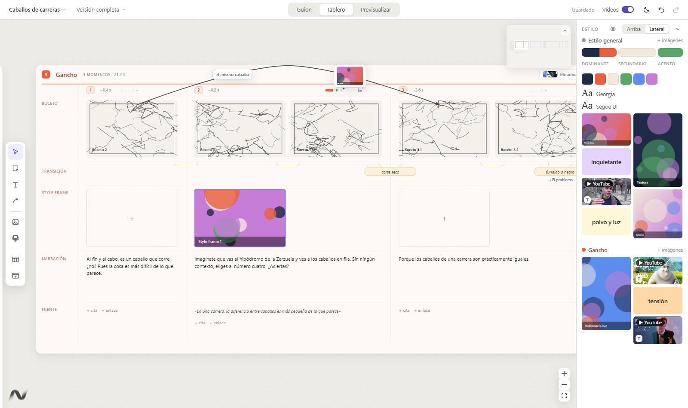

## Qué es y cómo se trabaja

StoryND sirve para preparar un vídeo **desde el guion hasta el storyboard**, en un mismo sitio: lo que se dice, de dónde sale y cómo se ve. Está pensada para vídeos con voz en off (divulgación, explicativos, piezas con narración), pero vale para cualquier vídeo que se pueda dividir en partes.

El trabajo suele ir así:

1. **Escribes o pegas el guion** en la vista **Guion**. Cada párrafo se convierte en un **momento**: un trozo del vídeo con su texto y su duración.
2. **Lo divides en zonas**: las partes del vídeo (gancho, problema, explicación, cierre…). Cada zona tiene su color.
3. **En el Tablero** cada zona es una tabla: una columna por momento y, en cada columna, sus **bocetos**, las **transiciones** entre planos, su **style frame**, la **narración** y sus **fuentes**.
4. **Defines el estilo**: la paleta con su reparto **60 / 30 / 10**, las tipografías y las fotos de referencia en «Estilo general»; y, si hace falta, la paleta, las imágenes y el moodboard de cada momento y de cada zona.
5. **Relacionas cosas** con **flechas** a mano alzada, notas y textos, como en Miro.
6. **Previsualizas**: el vídeo montado con sus tiempos, la narración como teleprompter y la línea de tiempo. Ahí ves si el ritmo funciona y ajustas duraciones.

Todo se guarda solo, en un único archivo por proyecto, y puedes tener **varias versiones** del mismo proyecto para probar ideas.

> Para probarlo todo sin tocar tus proyectos, abre **`Ejemplo/Caballos de carreras.storyboard`**: un vídeo completo con zonas, bocetos, style frames, transiciones, fuentes, paleta, tipografías, moodboards, notas, una flecha, un momento clave y dos versiones.

---

## Instalar y abrir

Hace falta **[Node.js](https://nodejs.org/) 20 o superior**. Después:

1. Descarga la app (en GitHub: **Code → Download ZIP**, y descomprímela).
2. Doble clic en **`Crear acceso directo.vbs`**: deja **StoryND** en el escritorio, con su icono.
3. Ábrela desde ese acceso directo. La primera vez tarda un poco porque instala lo que necesita; después se abre directamente, sin ventana negra.

Más cosas:
- **Abrir proyectos con doble clic** (una sola vez): **`Asociar archivos .storyboard.vbs`**. Desde entonces los archivos `.storyboard` llevan el icono de StoryND y se abren con doble clic (si la app ya está abierta, en la misma ventana). Solo afecta a tu usuario de Windows; **`Quitar asociacion .storyboard.vbs`** lo deshace.
- Si algo falla, **`Iniciar con consola (para errores).bat`** abre la app con la consola visible para ver el error.

---

## Proyectos y versiones

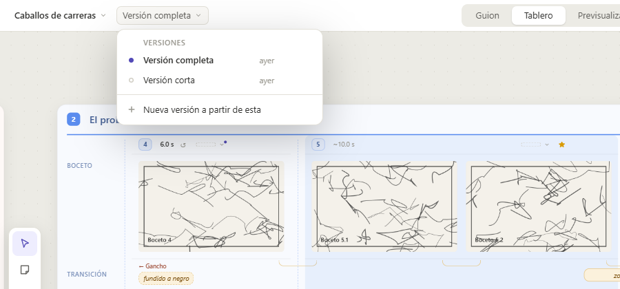

- Cada proyecto es **un archivo** `Nombre.storyboard`. Sus imágenes y vídeos van en una carpeta al lado, `Nombre.storyboard-media`; si mueves el proyecto, mueve las dos cosas juntas. **Se guarda solo** mientras trabajas.
- Al abrir la app sale el último proyecto. La pantalla de inicio tiene la lista de **recientes**.
- **Clic en el nombre del proyecto** (arriba a la izquierda): Nuevo proyecto, Abrir archivo y los recientes. La × de un reciente lo quita de la lista (no borra nada).
- **Versiones**, todas dentro del mismo archivo. Clic en la versión en uso (al lado del nombre):
  - clic en otra versión para trabajar en ella;
  - **Nueva versión a partir de esta**: una copia de la actual para probar otra idea sin perder la anterior;
  - el **lápiz** (al pasar el ratón) cambia el nombre; la **×** borra una versión (con **Deshacer** en el aviso).

---

## La pantalla

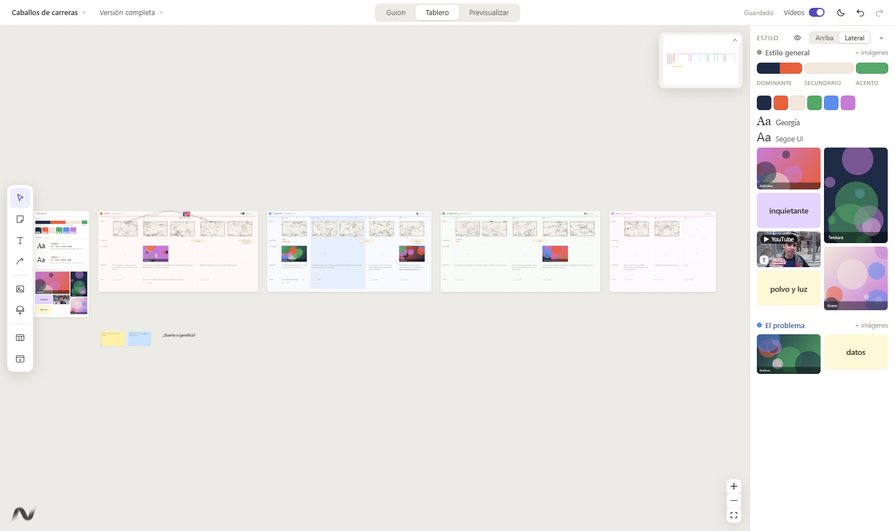

- **Arriba en el centro, las tres vistas: Guion · Tablero · Previsualizar.**
- **Arriba a la derecha:** si está guardado, el interruptor **Vídeos**, el modo **claro / oscuro** (☀ / ☾), **deshacer** y **rehacer** (Ctrl+Z, Ctrl+Y).
  - **Vídeos** encendido: los vídeos y GIF del tablero y de la franja se mueven. Apagado: se quedan quietos y el ordenador trabaja menos. En Previsualizar se reproducen siempre.
- **A la izquierda, las herramientas** (al pasar el ratón dicen qué son):

| Tecla | Herramienta |
|---|---|
| V | **Selección**. Arrastrar en un hueco selecciona varias cosas. |
| N | **Nota** (pósit): clic donde quieras ponerla. |
| T | **Texto grande**. |
| L | **Flecha** a mano alzada. |
| — | Imagen o vídeo suelto · Importar bocetos (varios a la vez) · Nueva zona · Nueva ventana (personajes, paleta…). |

- **Moverse:** rueda para el **zoom** (hasta ×4); **botón central** del ratón o **Espacio** mantenido para mover la vista. **Esc** vuelve a Selección.
- **A la derecha, la franja de estilo** (más abajo).
- **El mapa** (arriba a la derecha) se pliega con el botón de su esquina.

---

## Guion

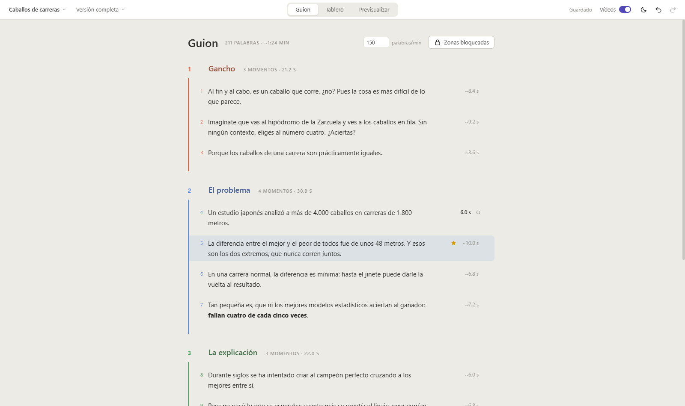

- La primera vez, **pega el guion entero**. Cada párrafo (separado por una línea en blanco) es un momento.
- **Escribir:** clic en el texto de una frase. Admite negrita, cursiva y color.
- **Segundos:** a la derecha de cada frase, su duración estimada por el texto; clic para poner la tuya.
- **Añadir:** pasa el ratón entre dos frases (o antes de la primera, o después de la última de cada zona) y sale **---- + texto ---- + zona ----**.
  - **+ texto**: una frase nueva ahí, lista para escribir.
  - **+ zona**: la zona nueva empieza ahí (o, en los extremos, una zona vacía delante o detrás).
- **Seleccionar:** clic en el **hueco** de una frase (no en el texto). **Mayús + clic** selecciona todas las del medio; **Ctrl + clic** añade o quita.
- **Mover:** arrastra desde el hueco; se mueven todas las seleccionadas, también a otra zona.
- **Mover una zona:** arrastra su fila de título (fuera del nombre). Se lleva todas sus frases.
- **Momento clave:** la **estrella** junto a los segundos (sale al pasar el ratón).
- **Doble clic** en el hueco de una frase: la enseña en el tablero. La **×** de la derecha la borra.
- **Zonas bloqueadas:** con el candado abierto se pueden arrastrar los separadores (⠿) o unir una zona con la anterior (su ×).

---

## Tablero: zonas y momentos

Cada **zona** es una tabla. Cada **momento** es una columna y tiene, de arriba abajo:

| Fila | Qué va |
|---|---|
| **Boceto** | Uno o varios bocetos del momento (suelta fotos o pulsa **+**). |
| **Transición** | Cómo se pasa de un plano al siguiente. |
| **Style frame** | El fotograma de estilo del momento. |
| **Narración** | El texto que se dice (el mismo del Guion). |
| **Fuente** | Citas y enlaces de donde sale la información. |

- **Fuentes:** una por línea, numeradas. **+ fuente** añade una; el **lápiz** de la derecha (al pasar el ratón) abre su ficha para escribir qué dice y, si quieres, su enlace (clic en la dirección para cambiarla). La **flechita** ↗ después del texto abre la web. Una fuente que dejas vacía desaparece sola; la papelera de la ficha la borra. Arrastra una línea para cambiarla de orden o llevarla a otro momento.
- **Cabecera de cada momento:** a la izquierda su **número** (arrástralo para mover el momento, también a otra zona) y sus **segundos** (clic para cambiarlos, **↺** vuelve a los estimados); a la derecha, su **paleta**, la **estrella** de momento clave, sus **descartes**, **ver en detalle** (⤢) y **borrar** (×).
- **Añadir un momento:** clic en la línea discontinua entre dos momentos.
- **Añadir una zona:** el **+** redondo que sale a la derecha de una zona al pasar el ratón, o el botón **Nueva zona** de la izquierda.
- **Mover una zona:** arrástrala por la parte vacía de su cabecera. El **número de color** es su orden en el vídeo; arrástralo sobre otra zona para cambiarlo.
- **Tamaño:** selecciona la zona (clic en su cabecera) y arrastra una esquina. Más grande, sus casillas crecen; no se puede hacer más pequeña que su tamaño natural. Ese tamaño se queda: si luego quitas o añades momentos o bocetos, los demás no cambian y es la zona la que se estrecha o se ensancha.
- **Textos largos:** la rueda encima de un texto que no cabe lo desplaza; al llegar al final, vuelve a hacer zoom.

### Transiciones
- Pasa el ratón por un momento: en la fila **Transición** sale **+ transición** en cada corte (después de cada boceto; el último es el paso al momento siguiente). Clic y escribe («corte seco», «fundido a negro»…).
- Si el momento todavía no tiene bocetos, también tiene su **+ transición** al siguiente; cuando le pongas bocetos, pasa a su último boceto.
- La transición del final de una zona dice a qué zona lleva, y la siguiente zona la enseña al empezar.

### Momentos clave

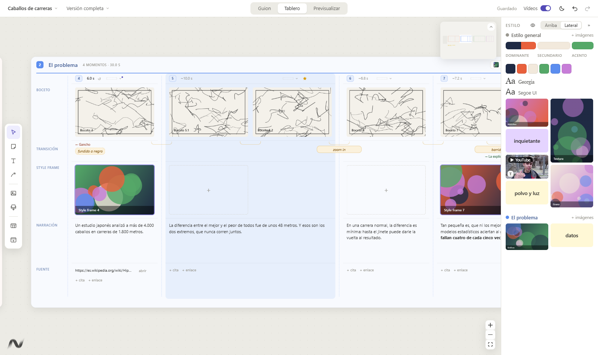

- La **estrella** de la cabecera (o la del Guion) marca un momento como **clave**: su columna toma el color de su zona, en el Guion la frase también, y en Previsualizar sus planos llevan un borde.

### Descripción y apuntes

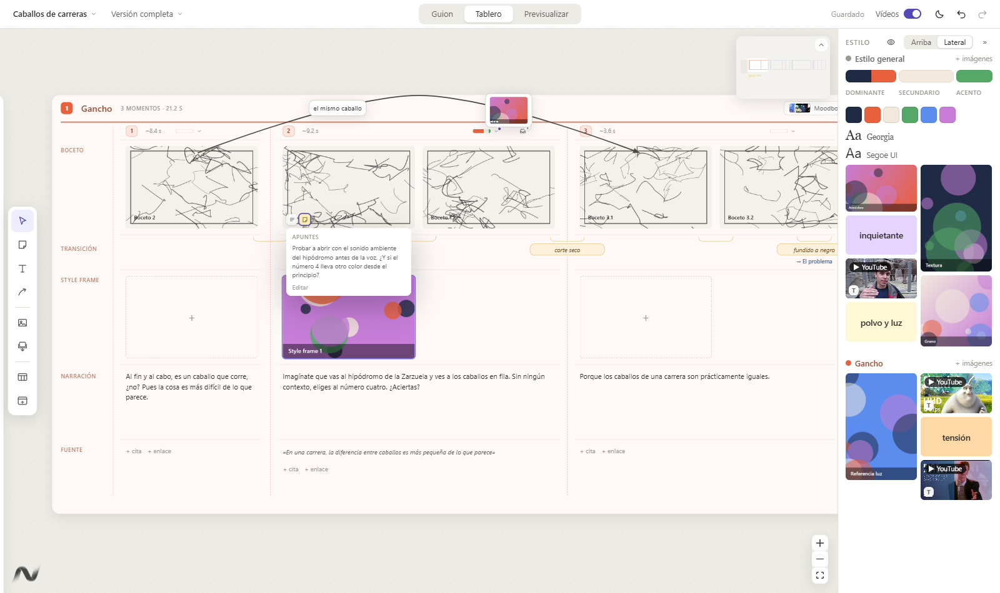

- Cada momento tiene una **descripción** (qué pasa en él) y unos **apuntes** (ideas sueltas). Se escriben en la vista de detalle.
- Si los tiene, al pasar el ratón por su boceto salen dos iconos abajo a la izquierda (líneas: descripción; nota amarilla: apuntes). Clic para leerlo; **Editar** abre el momento.

### Paleta e imágenes de cada momento

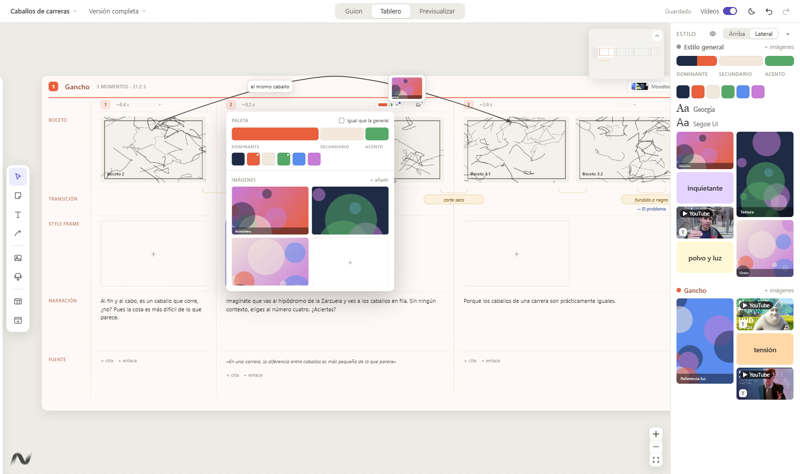

- El botón con la **paleta en pequeño**, junto a los segundos, abre su desplegable:
  - **Paleta:** su reparto **Dominante / Secundario / Acento**. Arrastra a la barra los colores del proyecto. Por defecto está marcado **Igual que la general**: usa la de «Estilo general» y la sigue si cambia. Desmárcalo para darle al momento su propia paleta.
  - **Imágenes:** las referencias de ese momento (**+ añadir** o suéltalas encima). Un puntito en el botón indica que tiene.
- Se cierra con un clic fuera o **Esc**.

### Moodboard de cada zona

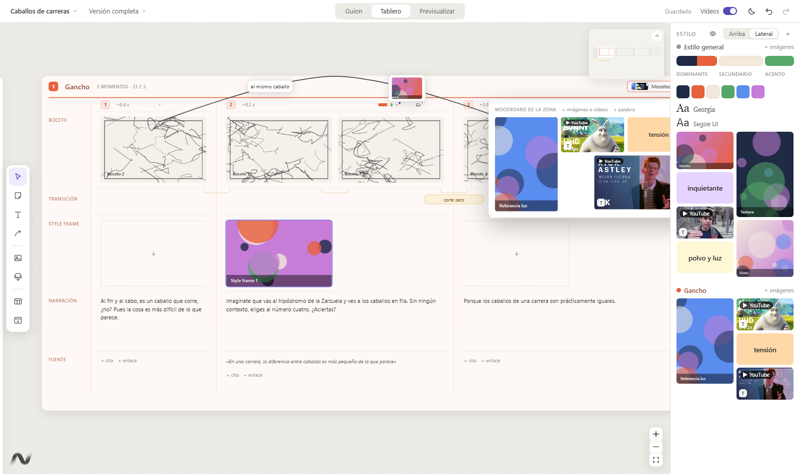

- El botón **Moodboard** de la cabecera de la zona (con miniaturas y cuántas tiene) lo despliega encima de los momentos. Lleva imágenes, vídeos y palabras. Puedes soltar imágenes directamente sobre el botón.

### Colocar y escalar en los moodboards

Los moodboards del tablero (Fotos del Estilo general, ventanas y el de cada zona) van en **columnas**:

- **Arrastra** una imagen y va a la columna que tiene debajo, a la altura donde la sueltes: puedes ponerla debajo de otra. Las demás se quedan en su columna; solo bajan las de esa columna para hacerle sitio. En la mano ya tiene el tamaño que tendrá.
- La **esquina** de abajo a la derecha (al dejar el ratón quieto encima) decide **cuántas columnas** ocupa: 1, 2, 3…
- Las imágenes nuevas van solas a la columna más corta. Nada se monta ni se recorta.
- Si cambias el ancho de la ventana, las imágenes no cambian de tamaño ni de sitio: al ensancharla queda hueco a la derecha; al estrecharla, solo bajan las que ya no caben (y vuelven a su sitio si la ensanchas otra vez).
- Sácala del moodboard para llevarla a una casilla, a otro moodboard o al tablero (con Alt, copia).

---

## Estilo general

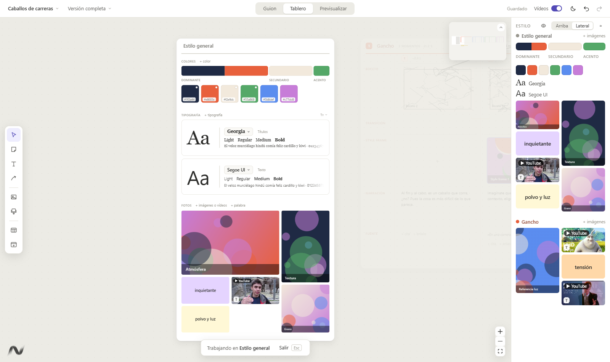

- **Colores:** la paleta del vídeo. Clic en un color para cambiarlo (con HEX, cuentagotas y RGB / CMYK / HSB). Arrastra un color para cambiarlo de sitio.
- **Reparto 60 / 30 / 10:** la barra de encima: **Dominante** (60 %), **Secundario** (30 %) y **Acento** (10 %). Arrastra los colores de la paleta a cada tramo; puede haber varios en cada uno. Su **×** los quita.
- **Tipografía:** hasta 3 fuentes de las instaladas, con sus pesos y una frase de muestra. La **escala tipográfica** (Display, Título, Subtítulo, Cuerpo, Etiqueta) se abre con **Tt**.
- **Fotos:** el moodboard general (imágenes, vídeos y palabras), en columnas: ver «Colocar y escalar en los moodboards».
- **Doble clic** en un hueco de la ventana la encuadra y apaga el resto del tablero; **Esc** vuelve.
- **Nueva ventana** (barra izquierda) crea ventanas generales extra, por ejemplo de personajes.

### La franja de estilo
- A la derecha, siempre a la vista: la paleta con su reparto, las tipografías, el moodboard general y el de la zona que tienes en pantalla (cambia sola al moverte).
- El **ojo** de su cabecera elige qué ventanas salen. **Arriba / Lateral** la cambia de sitio; **»** la pliega.
- Suelta imágenes en ella para añadirlas; la **×** (al pasar el ratón) las borra; clic para verlas en grande.
- En la franja, sus moodboards van en **filas**: **arrastra** una imagen para cambiarla de sitio entre las otras (en la mano ya tiene su tamaño final) o sácala a una casilla, otro moodboard o el tablero. La **esquina** hace más alta o más baja toda su fila, a saltos; la que deja de caber baja a la fila siguiente. Lo que colocas en la franja es solo de la franja: el moodboard del tablero no cambia (y la franja de arriba y la lateral van cada una por su lado). Arriba, si un moodboard no cabe, se desplaza.

---

## Flechas

- Pulsa **L** y dibuja con el botón izquierdo. Puedes seguir moviéndote con el botón central y la rueda.
- Cada extremo **se pega** a lo que tenga debajo (un boceto, una frase, una nota, una zona…) y lo sigue si se mueve.
- **Anclas**, como en Miro o Illustrator: con la flecha seleccionada aparecen sus puntos.
  - Arrastra un **ancla** para cambiar la curva; la curva pasa siempre por todas.
  - Clic en el **+** que hay entre dos anclas crea una nueva ahí (o arrástralo para colocarla donde quieras).
  - **Doble clic** en un ancla la quita.
  - Arrastra un **extremo** hasta otra cosa para pegarlo ahí.
- **Varias etiquetas** de texto y de imágenes en la misma flecha:
  - **+ texto** y **+ imagen** de su barra añaden una (la barra sale junto al ratón, al lado de la línea, y se queda quieta mientras vas hacia ella; lo nuevo se pone ahí); también doble clic en la línea o soltar una imagen encima de ella.
  - Arrastra una etiqueta para deslizarla a lo largo de la flecha; doble clic para escribir.
  - Su **×** la quita. **borrar** (o **Supr**) borra la flecha.

---

## Imágenes, vídeos y enlaces

- **Ctrl+V** pega donde está el ratón una imagen, un vídeo o un **enlace** de YouTube / Vimeo / .mp4 (se ve con su miniatura).
- **Arrastrar mueve; con Alt al soltar, copia.** Vale para todo: bocetos, style frames, moodboards, la franja, descartes, etiquetas de flechas e imágenes sueltas.
  - En una casilla, pasa a esa casilla. En un hueco del tablero, se queda suelta.
- **Doble clic** en una imagen la ve en grande (los vídeos de YouTube y Vimeo, con su reproductor).
- **Girar:** el botón **⟳** de la esquina (al pasar el ratón, junto a la ×) la gira un cuarto de vuelta. Solo esa: sus copias en otros sitios se quedan como estaban.
- **Sonido:** los vídeos suenan silenciados; pasa el ratón y pulsa el **altavoz** (al pasar por él sale el volumen).
- **Texto sobre una imagen** del moodboard: **+ añadir texto** al pasar el ratón; luego se lee sobre una franja de cristal.
- Los botones de una imagen (×, altavoz, tamaño…) salen al dejar el ratón quieto encima, así es fácil agarrarla para moverla.

## Notas, textos y orden

- **Notas** (N) y **textos grandes** (T): doble clic para escribir. Al seleccionarlos, su barra tiene color de la nota, alineación, **negrita**, *cursiva*, color del texto y **tamaño de letra** (A− / A+). Los botones B e I salen pulsados si el texto lo está.
- En cualquier texto, **selecciona unas palabras** y sale una barrita con negrita, cursiva y color.
- **Alt + arrastrar** duplica notas, textos e imágenes sueltas.
- **Capas:** lo suelto va encima de las zonas, y lo último que tocas queda arriba.
- **Alinear:** selecciona varias cosas (Mayús + clic, o un recuadro) y usa la barra que sale encima: alinear y repartir.
- Todo se coloca en una **cuadrícula**, así que los bordes quedan alineados al mover o cambiar de tamaño.

---

## Un momento en detalle

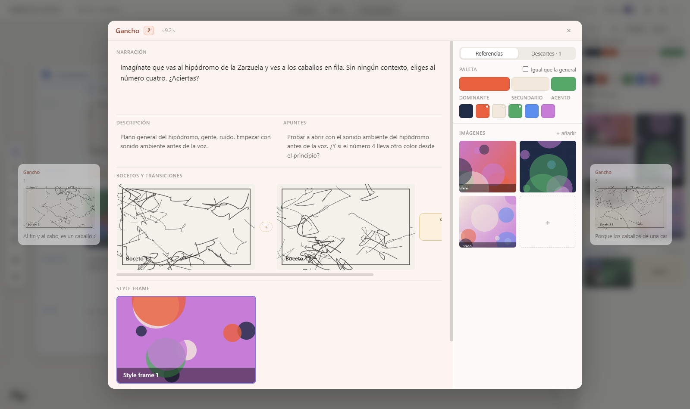

- Doble clic en un hueco del momento, o su botón **⤢**. A los lados, el anterior y el siguiente (**← →** para pasar).
- **Narración** arriba; debajo, **Descripción** y **Apuntes** a la misma altura; después bocetos con sus transiciones, style frame y fuente.
- A la derecha, dos pestañas:
  - **Referencias:** su paleta y sus imágenes, como en el desplegable del tablero.
  - **Descartes:** lo que quitas o sustituyes llega aquí solo. Para recuperarlo, arrástralo al boceto o al style frame; la **×** lo borra.
- **Esc** cierra.

---

## Previsualizar

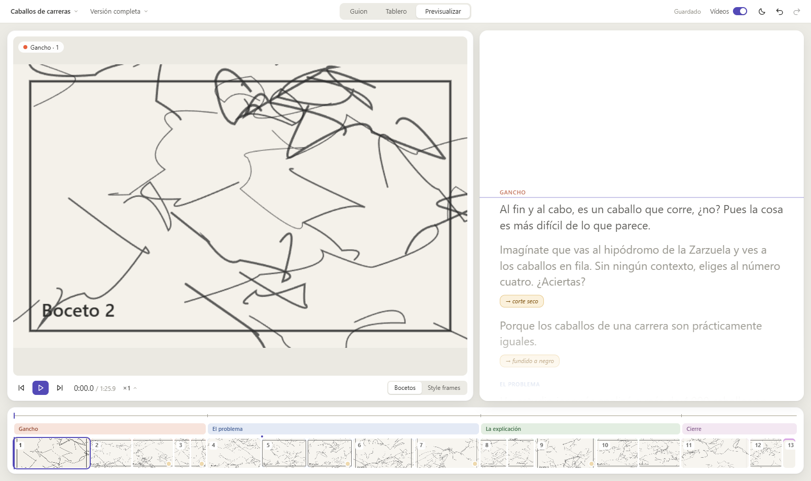

- **A la izquierda**, el plano en grande. **A la derecha**, la narración como **teleprompter**, que avanza al ritmo real, con las transiciones en amarillo. **Abajo**, la línea de tiempo con las zonas y los planos.
- **Espacio** reproduce o pausa; **← →** plano anterior y siguiente; **×1** cambia la velocidad.
- **Clic** en una frase o un plano: ir ahí. **Doble clic**: abrir ese momento para editarlo.
- **Duraciones:** cada momento dura lo que se tarda en leer su texto (o 2 s sin texto), repartido entre sus bocetos.
  - Arrastra el **borde derecho** de un momento en la línea de tiempo para cambiarlo; doble clic en ese borde vuelve al estimado.
  - Si le das menos tiempo del que hace falta para leerlo, sale una **línea roja**.
- **Bocetos / Style frames:** qué imágenes se reproducen.

---

## Modo oscuro

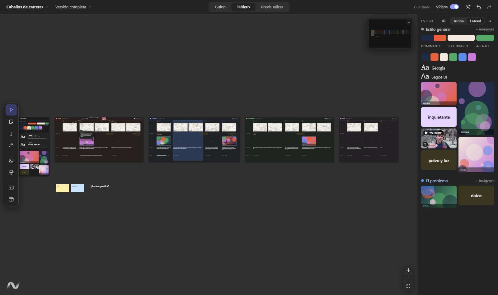

- El botón ☀ / ☾ de arriba a la derecha. Al principio sigue al de Windows; luego recuerda tu elección.

---

## Atajos

| Atajo | Qué hace |
|---|---|
| V · N · T · L | Selección · Nota · Texto grande · Flecha |
| Esc | Volver a Selección / cerrar |
| Espacio (mantener) o botón central | Mover la vista |
| Rueda | Zoom (o desplazar un texto largo) |
| Ctrl+Z · Ctrl+Y | Deshacer · Rehacer |
| Ctrl+V | Pegar imagen, vídeo, enlace o texto donde está el ratón |
| Ctrl+B · Ctrl+I | Negrita · Cursiva |
| Supr | Borrar lo seleccionado |
| Alt al soltar | Copiar en vez de mover |
| ← → | Momento anterior / siguiente (detalle y previsualizar) |
